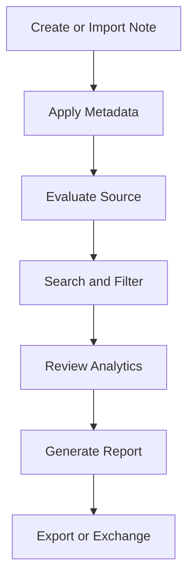
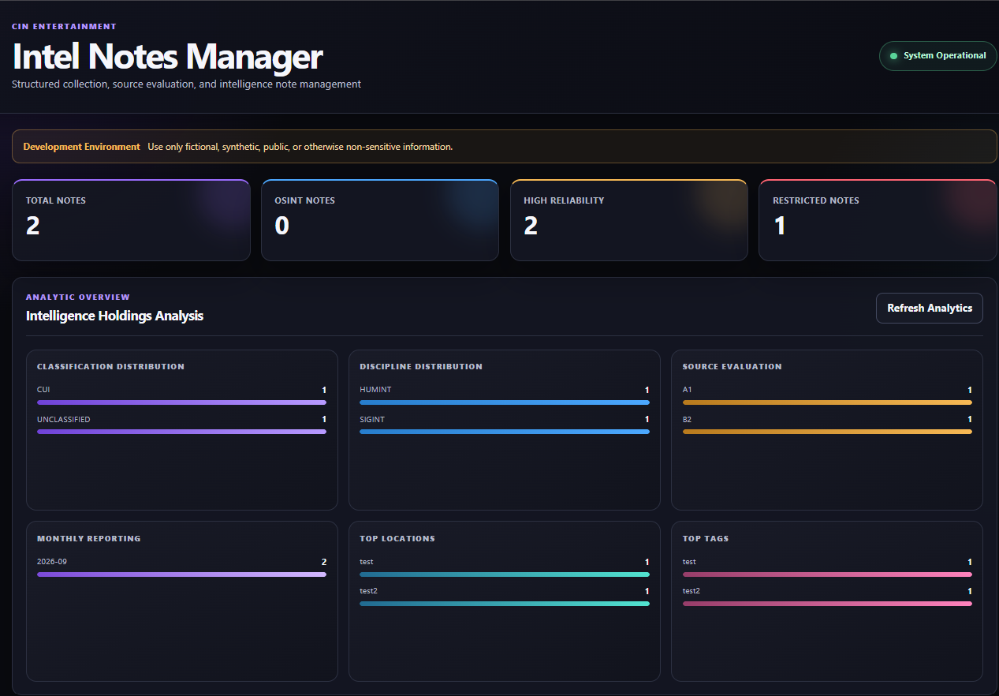
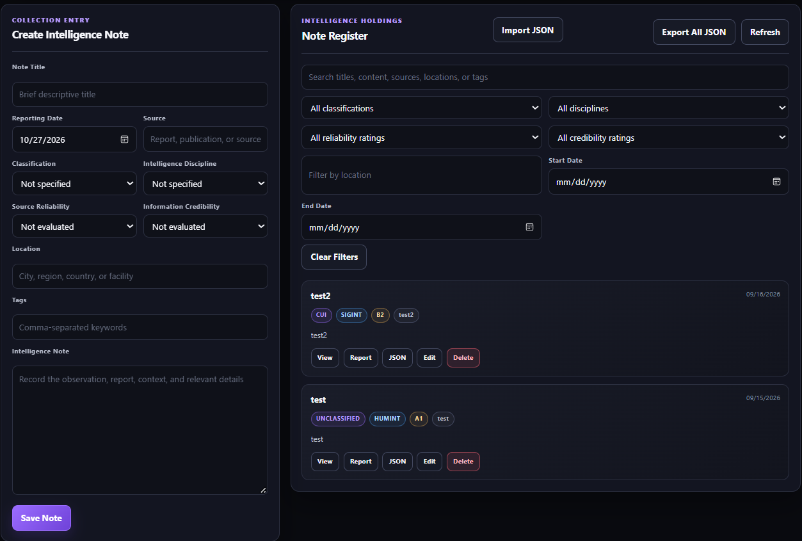
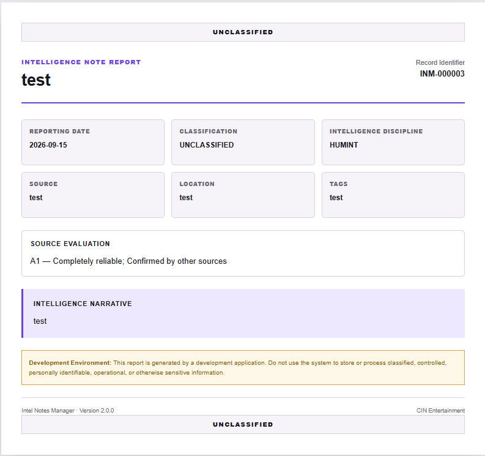

# Intel Notes Manager

A local intelligence-note collection, management, analysis, reporting, and interoperability application developed by CIN Entertainment.

Intel Notes Manager provides a structured workflow for recording intelligence information, evaluating sources, searching holdings, reviewing analytical distributions, producing printable reports, and exchanging standardized JSON records with other applications.

## Current Version

**Version 2.0.0 — Web Application**

Version 2.0 transforms the original command-line application into a browser-based FastAPI application while preserving the original SQLite data structure and command-line source code.

> Use only fictional, synthetic, public, or otherwise non-sensitive information. This application is not approved for classified information, controlled unclassified information, operational data, personally identifiable information, or other protected records.

## Core Capabilities

- Create, view, edit, and delete intelligence notes
- Search titles, narratives, sources, locations, and tags
- Filter notes by:
  - Classification
  - Intelligence discipline
  - Source reliability
  - Information credibility
  - Location
  - Reporting-date range
- Apply structured source-evaluation ratings
- Review intelligence holdings through dashboard statistics
- Analyze distributions by:
  - Classification
  - Intelligence discipline
  - Source evaluation
  - Reporting month
  - Location
  - Tags
- Generate printable individual-note reports
- Print reports or save them as PDF through the browser
- Export individual notes as standardized JSON
- Export the complete intelligence-note collection
- Import individual or collection JSON exports
- Detect and skip duplicate imports
- Validate API and interoperability data with Pydantic
- Preserve the original version 1 command-line application
- Store local development data in SQLite
- Verify application behavior with automated tests

## Application Workflow




Replace that entire section with:

```markdown
## Screenshots

### Intelligence Dashboard



### Intelligence Note Details



### Printable Intelligence Report



## Technology Stack

- Python 3.11
- FastAPI
- SQLAlchemy
- Pydantic
- SQLite
- Pytest
- HTML
- CSS
- JavaScript
- Uvicorn

## Project Structure

```text
intel-notes-manager/
├── app/
│   ├── static/
│   │   ├── app.js
│   │   ├── index.html
│   │   └── styles.css
│   ├── __init__.py
│   ├── analytics.py
│   ├── database.py
│   ├── exporting.py
│   ├── main.py
│   ├── models.py
│   ├── reporting.py
│   └── schemas.py
├── tests/
│   ├── test_analytics.py
│   ├── test_api.py
│   ├── test_database.py
│   ├── test_notes.py
│   ├── test_reporting.py
│   ├── test_search.py
│   └── test_validation.py
├── analytics.py
├── database.py
├── main.py
├── notes.py
├── reporting.py
├── search.py
├── validation.py
├── .gitignore
├── LICENSE
├── README.md
└── requirements.txt
```

The Python files in the repository root preserve the original Version 1 command-line application. The `app/` directory contains the Version 2 web application.

## Installation

### 1. Clone the repository

```powershell
git clone https://github.com/CINentertainment/intel-notes-manager.git
cd intel-notes-manager
```

### 2. Select the Version 2 development branch if needed

Until Version 2 is merged into `main`:

```powershell
git switch v2-development
```

### 3. Create a virtual environment

```powershell
py -m venv .venv
```

### 4. Activate the virtual environment

```powershell
.\.venv\Scripts\Activate.ps1
```

If PowerShell blocks script execution:

```powershell
Set-ExecutionPolicy -Scope Process -ExecutionPolicy RemoteSigned
.\.venv\Scripts\Activate.ps1
```

### 5. Install dependencies

```powershell
python -m pip install --upgrade pip
python -m pip install -r requirements.txt
```

## Running the Version 2 Web Application

Start the development server:

```powershell
python -m uvicorn app.main:app --reload
```

Open the dashboard:

```text
http://127.0.0.1:8000/dashboard
```

Open the interactive API documentation:

```text
http://127.0.0.1:8000/docs
```

Open the alternative API documentation:

```text
http://127.0.0.1:8000/redoc
```

Stop the server by pressing:

```text
Ctrl + C
```

## Running the Version 1 Command-Line Application

The original command-line application remains available:

```powershell
python main.py
```

The command-line menu supports note creation, viewing, searching, editing, deletion, analytics, and analytical-report exports.

## Running the Tests

Run the complete automated test suite:

```powershell
python -m pytest -v
```

Version 2 currently contains **81 automated tests** covering:

- Root and health endpoints
- Dashboard availability
- Application-version consistency
- Intelligence-note creation
- Intelligence-note retrieval
- Intelligence-note updates
- Intelligence-note deletion
- Keyword searching
- Classification filtering
- Date-range filtering
- Input validation
- Missing-resource responses
- Dashboard statistics
- Analytical distributions
- Printable intelligence-note reports
- Individual JSON exports
- Collection JSON exports
- JSON imports
- Duplicate-import protection
- Invalid-import rejection
- Original Version 1 database behavior
- Original Version 1 validation
- Original Version 1 analytics
- Original Version 1 reporting
- Original Version 1 search operations

## Intelligence-Note Fields

Each note may contain:

| Field | Purpose |
|---|---|
| Title | Brief descriptive name |
| Reporting Date | Date associated with the information |
| Source | Origin of the information |
| Classification | Handling or classification marking |
| Discipline | Intelligence discipline associated with the note |
| Location | Relevant city, region, country, facility, or area |
| Tags | Comma-separated keywords |
| Source Reliability | Reliability rating for the source |
| Information Credibility | Credibility rating for the information |
| Narrative | Full intelligence-note content |

## Source Evaluation

Intel Notes Manager supports structured source evaluation through separate reliability and credibility values.

Example:

```text
Reliability: B
Credibility: 2
Combined evaluation: B2
```

These values are displayed on the dashboard, included in reports, represented in analytics, and preserved in JSON exports.

## Dashboard Analytics

The dashboard provides distributions for:

- Classification
- Intelligence discipline
- Combined source evaluation
- Reporting month
- Location
- Tags

Summary statistics also identify:

- Total intelligence notes
- OSINT notes
- Notes with high-reliability sources
- Notes carrying restricted classification markings

## Printable Reports

Each intelligence note includes a **Report** button.

The printable report contains:

- Record identifier
- Title
- Reporting date
- Classification
- Intelligence discipline
- Source
- Location
- Tags
- Source evaluation
- Intelligence narrative

Use the report page’s print control to print the record or save it as a PDF through the browser.

## JSON Interoperability

Version 2 introduces a standardized JSON exchange format.

### Export One Note

Select the **JSON** button on an intelligence-note card.

The application downloads a file similar to:

```text
intel-note-INM-000001.json
```

### Export All Notes

Select **Export All JSON** from the Note Register.

The application downloads a dated collection file similar to:

```text
intel-notes-export-2026-10-27.json
```

### Import Notes

Select **Import JSON**, then choose either:

- A single-note export
- A complete collection export

The application validates the file, imports new records, and skips exact duplicates.

### Interoperability Purpose

The JSON structure is designed to support future information exchange with:

- Protective Intelligence Risk Tracker
- Threat Intelligence Aggregator
- Artemis
- Other CIN Entertainment analytical applications

The application version and exchange-schema version are tracked separately. Intel Notes Manager Version 2.0.0 currently uses interoperability schema Version 1.0.

## API Overview

| Method | Endpoint | Purpose |
|---|---|---|
| `GET` | `/` | View application information |
| `GET` | `/health` | Check application health |
| `GET` | `/dashboard` | Open the web dashboard |
| `GET` | `/analytics` | Retrieve analytical distributions |
| `GET` | `/notes` | List and filter notes |
| `POST` | `/notes` | Create a note |
| `GET` | `/notes/{note_id}` | Retrieve one note |
| `PATCH` | `/notes/{note_id}` | Update a note |
| `DELETE` | `/notes/{note_id}` | Delete a note |
| `GET` | `/notes/{note_id}/report` | View a printable note report |
| `GET` | `/notes/{note_id}/export` | Export one note as JSON |
| `GET` | `/exports/notes` | Export all notes as JSON |
| `POST` | `/imports/notes` | Import a standardized JSON note |

## Data Storage

Intel Notes Manager uses a local SQLite database:

```text
intel_notes.db
```

The database is excluded from Git version control through `.gitignore`. This prevents locally stored intelligence-note records from being uploaded to the public repository.

Generated reports, virtual environments, cache files, and other local development artifacts are also excluded.

## Security Status

Version 2 is designed for local development, demonstration, education, and portfolio use.

The current release does not include:

- User authentication
- Role-based authorization
- Encryption at rest
- Organizational data separation
- Production database migrations
- Formal security certification
- Independent penetration testing

Only fictional, synthetic, public, or otherwise non-sensitive information should be entered.

## Version History

### Version 2.0.0 — Web Application

- Added FastAPI web API
- Added SQLAlchemy models
- Added Pydantic request and response validation
- Added browser-based intelligence dashboard
- Added CRUD controls
- Added search and filtering
- Added dashboard statistics
- Added analytical distributions
- Added printable note reports
- Added standardized JSON exports
- Added individual and collection imports
- Added duplicate-import protection
- Expanded the automated test suite
- Preserved Version 1 database compatibility
- Preserved the Version 1 command-line application

### Version 1.0.0 — Command-Line Application

- Added SQLite intelligence-note storage
- Added command-line CRUD operations
- Added structured validation
- Added keyword search
- Added multi-field filtering
- Added source evaluation
- Added analytical distributions
- Added text-based analytical reports
- Added automated tests

## Future Development

Potential future enhancements include:

- Authentication
- Role-based authorization
- Named-user activity records
- Note relationships and link analysis
- Entity extraction
- Watchlists
- Intelligence requirements
- Collection-gap tracking
- Source registries
- Attachments
- PostgreSQL support
- Alembic database migrations
- Integration with the Protective Intelligence Risk Tracker
- Automated Artemis ingestion and analysis

These capabilities are outside the Version 2.0.0 local-release scope.

## Development Status

**Version 2.0.0 feature set complete.**

The application is undergoing final documentation, screenshot, smoke-testing, branch-merging, and release preparation.

## License

See the repository’s `LICENSE` file for applicable terms.

## Developer

Developed by **CIN Entertainment** as part of an expanding portfolio of intelligence, risk-management, automation, and analytical software.